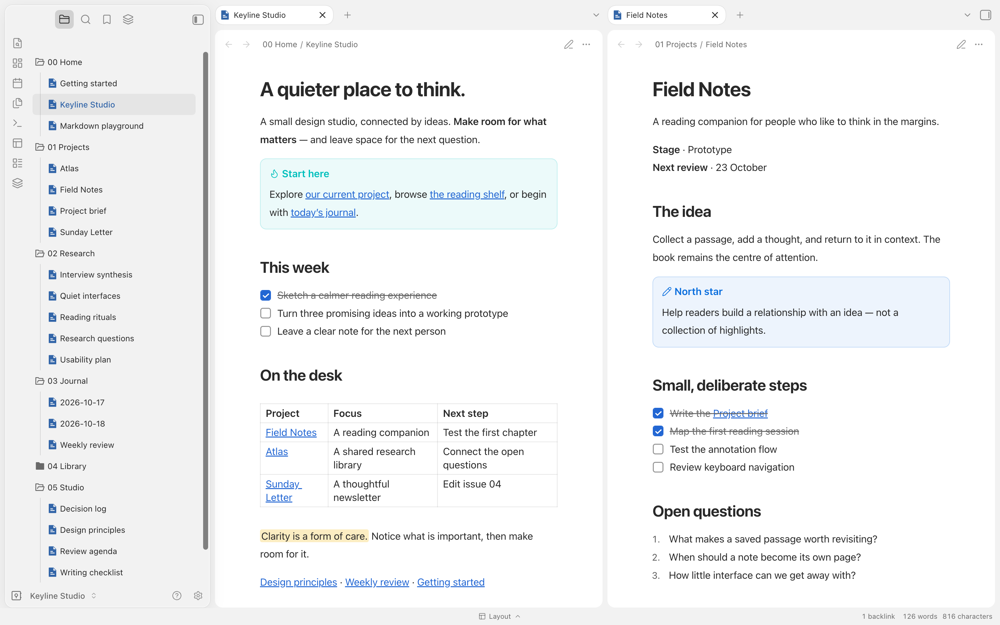
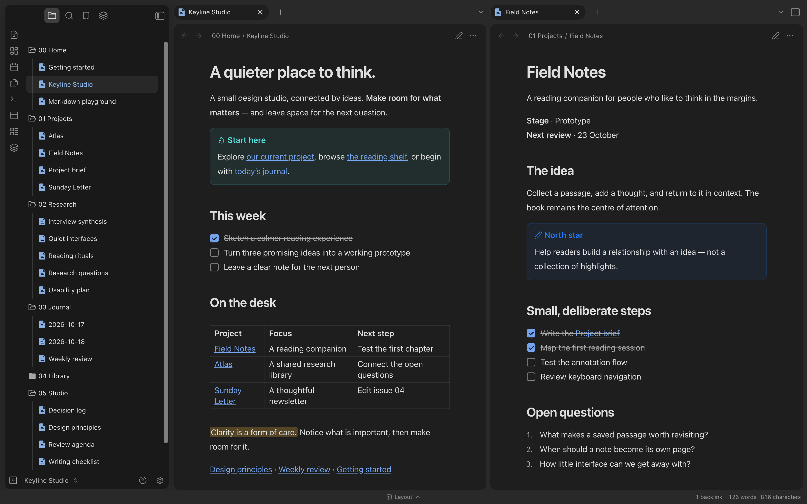

# Keyline

让思考，少一点干扰。Keyline 是一款克制的 Obsidian 主题，提供明暗外观、浮动导航面板和舒适的阅读留白。

[English](README.md) · [下载](https://github.com/BADtoBad/obsidian-keyline/releases) · [Figma 展示](https://www.figma.com/design/MVtMgxbXIPdd0FbkLH7D8S)

## 组成

- **Keyline 主题**：界面外观、正文排版、表格、callout 与安静的分屏边界，可单独使用。
- **[Keyline 交互插件](https://github.com/BADtoBad/keyline-interactions)**，可选：块编辑、选区工具栏、文件图标、排版设置和底栏工作区切换。
- **[Bucket Sidebar](https://github.com/BADtoBad/obsidian-bucket-sidebar)**，可选：按需组织文件引用，不移动原文件。

封面展示的是主题加两个可选插件。纯 CSS 主题不能提供交互功能。本次发行不包含 Marginalia 和 Journal View。

## 体验示例库

从 Releases 下载 **Keyline-Studio-Demo.zip**，解压后在 Obsidian 中选择“打开本地仓库”，从 `00 Home/Keyline Studio.md` 开始。

示例包含 25 篇全英文的项目、研究、日记、阅读、工作方法和模板笔记，全部是虚构内容。附带插件按需启用，请先查看其说明。

## 安装到现有库

1. 备份 Vault 的 `.obsidian` 文件夹，并关闭该库窗口。
2. 新建 `.obsidian/themes/Keyline/`，放入主题发行包中的 `theme.css` 和 `manifest.json`。再次分发时保留许可证和第三方声明。
3. 重新打开 Obsidian，在“设置 → 外观 → 主题”选择 Keyline。
4. 如需交互功能，另行安装可选插件。不要用示例库的工作区或插件 `data.json` 覆盖自己的配置。

目前为手动安装发行。发布到 GitHub 不代表已被 Obsidian Community 收录。

## 语言与兼容性

主题不改变 Obsidian 本身的语言。配套插件的菜单、设置与提示支持中文和英文，跟随 Obsidian 的界面语言；切换语言后重启即可。笔记正文、既有路径和自定义名称不会被翻译。

最低声明版本为 **Obsidian 1.7.7**。本次封面和双语界面在 **macOS 的 Obsidian 1.13.7** 中验证；此前主题回归也覆盖过 1.7.7，但不等于所有老 Mac 和第三方插件组合都经过实机验证。交互插件仅支持桌面端，移动端布局尚未完成发行验收。

## 反馈与许可

提交问题时请附 Obsidian/Keyline 版本、明暗模式、复现步骤和不含隐私的截图。冲突问题建议在测试库中排除其他主题片段和无关插件。

MIT 许可，详见 [LICENSE](LICENSE) 与 [第三方声明](THIRD_PARTY_NOTICES.md)。
