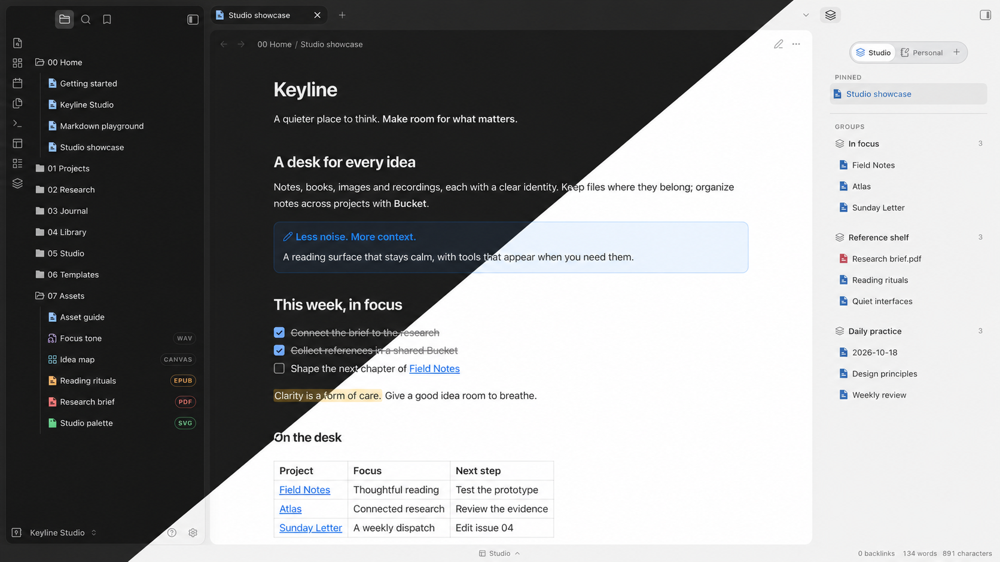

# Keyline

让思考，少一点干扰。Keyline 是一款克制的 Obsidian 主题，提供明暗外观、浮动导航面板和舒适的阅读留白。

[English](README.md) · [下载](https://github.com/BADtoBad/obsidian-keyline/releases) · [Figma 展示](https://www.figma.com/design/MVtMgxbXIPdd0FbkLH7D8S)

## 推荐搭配安装

**想获得下方截图中的完整体验，建议一起安装 Keyline 主题、Keyline 交互插件和 Bucket Sidebar。** 只想使用外观，也可以单独安装主题；两个插件都不是必需依赖。

| 组件 | 提供什么 | 何时安装 |
| --- | --- | --- |
| **Keyline 主题** — 本仓库 | 明暗外观、阅读区域、表格、callout 与分屏样式 | 需要主题外观时。 |
| **[Keyline 交互插件](https://github.com/BADtoBad/keyline-interactions)** — 在 Obsidian 插件列表中显示为 **Keyline** | 块编辑、格式工具栏、文件类型图标、排版设置与工作区切换 | 需要截图中的编辑和导航功能时。[下载预览版](https://github.com/BADtoBad/keyline-interactions/releases)。 |
| **[Bucket Sidebar](https://github.com/BADtoBad/obsidian-bucket-sidebar)** | Space、置顶引用与自定义分组，不移动原文件 | 需要截图右侧的分组侧栏时。[下载](https://github.com/BADtoBad/obsidian-bucket-sidebar/releases)。 |

因此是 **3 个仓库：1 个主题 + 2 个可分别安装的插件**，并非重复创建。两个插件按需安装、互不依赖，安装主题也不会自动安装或启用插件。两个插件均提供中英文界面、双语说明及各自的功能截图，点击上方链接查看。

Keyline 交互插件目前是 **GitHub 预览版，尚未提交 Community**。主题和 Bucket 的进度可在 [主题介绍页](https://community.obsidian.md/themes/keyline)及 [Bucket 介绍页](https://community.obsidian.md/plugins/bucket-sidebar)查看；页面公开不代表已通过审核或已开放 Community 安装，也可按下方说明手动安装。

[亮色原始截图](assets/keyline-showcase-light.png) · [暗色原始截图](assets/keyline-showcase-dark.png)

封面展示的是主题加两个可选插件。纯 CSS 主题不能提供交互功能。本次发行不包含 Marginalia 和 Journal View。

## 体验示例库

从 Releases 下载 **Keyline-Studio-Demo-0.8.23.zip**，解压后在 Obsidian 中选择“打开本地仓库”，从 `00 Home/Studio showcase.md` 开始。

示例包含 27 篇全英文笔记，以及原创 PDF、EPUB、图片、音频与 Canvas 样例，全部是虚构内容。展示附件分类图标、Bucket 分组、克制的强调色和工作区导航；EPUB 阅读本身需另装阅读器。附带插件按需启用。斜切封面为展示合成图，明暗完整截图来自实际应用。

当前版本 **0.8.23** 完成 Community 规范清理，未测出视觉变化；覆盖范围及限制见 [发行验证](RELEASE-VERIFICATION.md)。

## 安装到现有库

1. 备份 Vault 的 `.obsidian` 文件夹，并关闭该库窗口。
2. 新建 `.obsidian/themes/Keyline/`，放入主题发行包中的 `theme.css` 和 `manifest.json`。再次分发时保留许可证和第三方声明。
3. 重新打开 Obsidian，在“设置 → 外观 → 主题”选择 Keyline。
4. 如需交互功能，另行安装可选插件。不要用示例库的工作区或插件 `data.json` 覆盖自己的配置。

目前为手动安装发行。发布到 GitHub 不代表已被 Obsidian Community 收录。

## 语言与兼容性

主题不改变 Obsidian 本身的语言。配套插件的菜单、设置与提示支持中文和英文，跟随 Obsidian 的界面语言；切换语言后重启即可。笔记正文、既有路径和自定义名称不会被翻译。

最低声明版本为 **Obsidian 1.7.7**。本次封面和双语界面在 **macOS 的 Obsidian 1.13.7** 中验证；此前主题回归也覆盖过 1.7.7，但不等于所有老 Mac 和第三方插件组合都经过实机验证。交互插件仅支持桌面端，移动端布局尚未完成发行验收。

## 反馈与许可

提交问题时请附 Obsidian/Keyline 版本、明暗模式、复现步骤和不含隐私的截图。冲突问题建议在测试库中排除其他主题片段和无关插件。

MIT 许可，详见 [LICENSE](LICENSE) 与 [第三方声明](THIRD_PARTY_NOTICES.md)。
